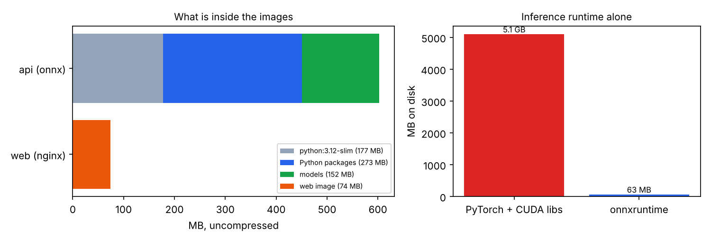
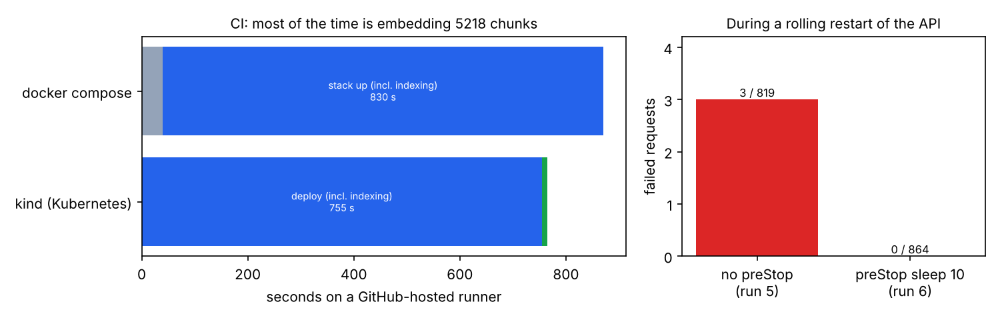

# 17 · Containers, microservices, Kubernetes, CI/CD and Terraform

🇸🇰 [Slovenská verzia](README.sk.md)

## TL;DR
- The step 15 RAG app split into 4 services: **qdrant**, a one-shot **indexer** job, the **api**, and **web**
  (nginx serving React). Run as docker compose and as Kubernetes (kind), with a Terraform platform layer, and
  tested end to end on every push by GitHub Actions.
- **Serving image without PyTorch:** onnxruntime (63 MB) instead of PyTorch + CUDA libraries (5.1 GB). Retrieval
  quality is **identical** to the PyTorch version on all 141 questions (rerank evidence@5 = 0.992, dense = 0.968).
  The API image is 866 MB, including 152 MB of baked-in models. The API container is healthy 5.6 s after start.
- **CI quality gate:** after deploying the stack, CI runs the real retrieval eval against it and fails the pipeline
  below the thresholds measured in step 15 (dense ≥ 0.95, rerank ≥ 0.98). Run #6 passed.
- **Zero-downtime rollout, measured:** a rolling restart of the API under constant traffic lost **3 of 819**
  requests even with `maxUnavailable: 0`. Adding a `preStop` pause fixed it: **0 of 864**.



## Problem
A notebook-quality app isn't deployable: it has to be built reproducibly, started in the right order, configured
from outside, upgraded without downtime, and checked automatically for regressions, including *quality*
regressions that unit tests don't catch. This step does that for the step 15 app and measures what each piece costs
or buys.

## Setup
- **App:** `app/` is the step 15 code, copied at commit `7138329` plus a torch/onnx switch (see `app/SOURCE.md`).
- **Local:** docker 29.9 + compose v5.6 in a cloud Linux session (4 cores). This machine can't run nested
  Kubernetes, so Kubernetes runs only in CI.
- **CI:** GitHub Actions `ubuntu-latest` (`.github/workflows/ci.yml`), 4 jobs: lint + unit tests, Terraform
  fmt/validate, compose + smoke test + eval gate, and kind deploy + rolling restart under load.
- **Raw numbers:** `measurements/*.json`, copied from the local runs and the CI job logs.

## How it works
```
                 ┌──────────── docker compose / Kubernetes (kind) ────────────┐
browser ─► web (nginx: React build, /api proxy, SSE unbuffered) ─► api (FastAPI, BM25, onnx embed + rerank)
                                                                      │  ▲ chunks (read-only volume)
                                         indexer job (download → chunk → embed) ─► qdrant (StatefulSet + PVC)
Terraform: namespace, quota, limit range, config map      kustomize: workloads      CI: build → test → deploy → gate
```
- **Images** (`docker/`):
  - **API image**, built in two stages. Build tools stay in the first stage. The dependency layer is cached until
    `uv.lock` changes, so a code edit rebuilds in seconds. Models are downloaded at build time: pods start without
    internet, and every replica runs the same weights. It runs as a non-root user and has a healthcheck.
  - **Web image**: nginx with `proxy_buffering off` for `/api`, otherwise the SSE answer stream would arrive all at
    once.
- **Behind a corporate proxy** (`docker/withca.sh`): the proxy's CA is passed as a BuildKit *secret*. It is mounted
  only while a `RUN` step executes and never ends up in a layer. This session needed it, and so do many enterprise
  networks.
- **Compose** (`compose.yaml`): health-gated startup (qdrant healthy → indexer completed → api healthy → web). The
  API has a read-only root filesystem and memory and CPU limits. Only the UI is published, and only on localhost.
- **Kubernetes** (`k8s/`):
  - **qdrant** is a StatefulSet with a persistent volume, and the **indexer** is a Job.
  - The **api** Deployment has 2 replicas with startup, readiness and liveness probes. An init container waits
    for the index instead of letting the pod crash-loop.
  - Each pod runs with a read-only root filesystem and all Linux capabilities dropped. A PodDisruptionBudget keeps
    at least one replica up.
  - Rollouts use `maxUnavailable: 0`, and a `preStop` hook pauses the pod before it stops (see Results).
- **Terraform** (`infra/`) owns the platform layer: namespace, resource quota, default limits and the config map.
  Kustomize owns the workloads, so an app release doesn't need a Terraform run. In CI, Terraform applies against
  the kind cluster; in step 18 the same layer targets AWS.
- **Visual example:** the two charts in this README, the image contents and the rollout before/after. The Racing Lab
  cars were not used because deployment plumbing has no natural driving analogue.

## Results
### PyTorch vs onnxruntime in the serving image
| | PyTorch (step 15) | onnxruntime (this step) |
|---|---|---|
| Inference runtime on disk | 5.1 GB (torch + nvidia + triton) | 63 MB |
| rerank evidence@5 / dense evidence@5 (141 questions) | 0.992 / 0.968 | **0.992 / 0.968** (identical, also inside the container against the Qdrant server) |
| dense query latency p50 (cloud CPU) | 144 ms | 53 ms (in container) |

The PyTorch image itself wasn't built: building it filled the session's disk. The 5.1 GB is the size of those
packages in the step 15 environment.

### CI (GitHub-hosted runner)
| | Result |
|---|---|
| Image build with layer cache | 40 s |
| compose: up to all healthy (mostly indexing 5218 chunks) | 830 s |
| api healthy after the indexer finished | 5.6 s |
| Smoke test through nginx (health, search, SSE answer) | pass |
| Eval gate: dense / rerank evidence@5 | 0.968 / 0.992 → **pass** |
| kind: apply → indexer done → api + web ready | 755 s |
| Rolling restart of 2 API pods | 10 s |
| Failed requests during the restart, no `preStop` (run #5) | **3 / 819** |
| Failed requests during the restart, `preStop: sleep 10` (run #6) | **0 / 864** |



## Error analysis
Every fix below was found by CI or a measurement, not by reading the manifests:
- **"Zero-downtime" `maxUnavailable: 0` wasn't zero-downtime.** Kubernetes removes a terminating pod from the
  Service endpoints *at the same time* as it sends SIGTERM, so for a moment traffic still went to a stopping pod
  (2 HTTP errors and 1 timeout). The `preStop` pause gives endpoint removal time to propagate.
- **The first deploy hit the default 600 s `progressDeadlineSeconds`.** The API pods waited correctly for an
  indexing job that took 846 s on the runner. The deadline is now 1800 s, with a comment explaining why.
- **qdrant-client 1.20 warned that a 1.12 server is incompatible.** The server is now pinned to 1.20.0.
- **The eval crashed inside the onnx image** because it imported torch just to print the hardware. Found by the
  gate on the first run.
- **Indexing dominates every deploy (12–14 min on CI).** ONNX made serving lighter, but bulk embedding on the 4-core
  runner was slower than PyTorch was on the session's CPU (715–846 s vs 356 s; different machines, so only
  indicative). A real system would index once into persistent storage, or on a GPU, rather than on every deploy.
- **Rerank costs ~3 s per query on CI CPUs** (p50 3.1 s). It's the right quality choice (evidence@1 0.857 vs 0.492
  for hybrid), but a production API would need a GPU or a smaller reranker for it.

## What I learned
- The eval gate is the part unit tests can't replace: a container can be "healthy" and still retrieve worse.
- Kubernetes defaults aren't zero-downtime. You need probes, `maxUnavailable: 0` *and* a pre-stop pause, and only a
  measurement under load shows the difference.
- Most serving-image weight is the ML runtime. ONNX removes PyTorch without changing a single result.
- Split ownership: Terraform for the platform, kustomize for releases, secrets only as build secrets or from the
  environment.

## Run it
```bash
scripts/build.sh                                       # api + web images (EXTRA_CA/PROXY only behind a proxy)
docker compose up -d --no-build --wait                 # qdrant → indexer → api → web
scripts/smoke.sh                                       # health, search, SSE through nginx
open http://localhost:8080                             # the UI
# Kubernetes on the Mac (Docker Desktop + kind):
kind create cluster --name rag
kind load docker-image rag-clinical-api:dev rag-clinical-web:dev --name rag   # tag :ci for the overlay, or edit it
(cd infra && terraform init && terraform apply -var kube_context=kind-rag)
kubectl apply -k k8s/overlays/kind
```
`LLM_PROVIDER=fake` is the default in compose (smoke tests). For real answers on the Mac use
`LLM_PROVIDER=ollama`, which reaches Ollama on the host through `host.docker.internal`.

## Limitations
- Kubernetes was measured on a single-node kind cluster in CI, not on a real multi-node cluster. The `appdata`
  volume is ReadWriteOnce, which only works because everything runs on one node.
- No registry, image signing or vulnerability scanning yet; images are loaded straight into kind.
- No autoscaling (HPA needs metrics-server) and no ingress controller; the UI is reached with a port-forward.
- Local timings come from a shared, busy CPU and are upper bounds.
