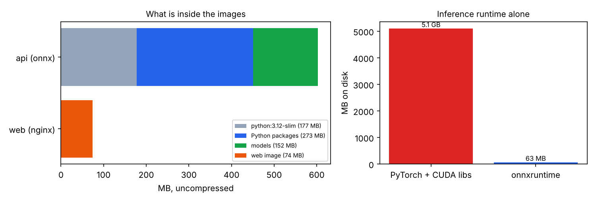
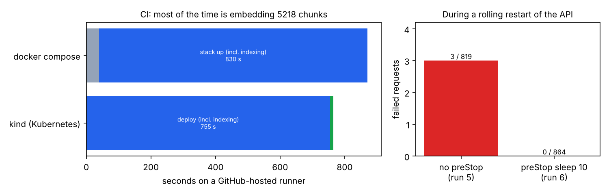

# 17 · Kontajnery, mikroslužby, Kubernetes, CI/CD a Terraform

🇬🇧 [English version](README.md)

## TL;DR
- RAG aplikácia z kroku 15 rozdelená na 4 služby: **qdrant**, jednorazový **indexer** job, **api** a **web**
  (nginx servírujúci React). Beží ako docker compose aj v Kubernetes (kind), s platformovou vrstvou v Terraforme,
  a GitHub Actions ju pri každom pushi otestuje od začiatku do konca.
- **Image na servírovanie bez PyTorchu:** onnxruntime (63 MB) namiesto PyTorchu + CUDA knižníc (5,1 GB). Kvalita
  vyhľadávania je na všetkých 141 otázkach **rovnaká** ako s PyTorchom (rerank evidence@5 = 0,992, dense = 0,968).
  API image má 866 MB vrátane 152 MB zabalených modelov. API kontajner je zdravý 5,6 s po štarte.
- **Quality gate v CI:** po nasadení stacku CI spustí proti nemu skutočný eval vyhľadávania a pipeline zlyhá, ak
  klesne pod prahy namerané v kroku 15 (dense ≥ 0,95, rerank ≥ 0,98). Beh #6 prešiel.
- **Nasadenie bez výpadku, zmerané:** rolling restart API pod stálou záťažou stratil **3 z 819** požiadaviek, hoci
  bolo nastavené `maxUnavailable: 0`. Pauza v `preStop` to opravila: **0 z 864**.



## Problém
Aplikácia na úrovni notebooku sa nedá nasadiť. Treba ju reprodukovateľne zostaviť, spustiť v správnom poradí,
konfigurovať zvonka, aktualizovať bez výpadku a automaticky kontrolovať na regresie, vrátane regresií v *kvalite*,
ktoré unit testy nezachytia. Tento krok to robí pre aplikáciu z kroku 15 a meria, čo ktorá časť stojí alebo prinesie.

## Setup
- **Aplikácia:** `app/` je kód z kroku 15 skopírovaný pri commite `7138329` plus prepínač torch/onnx (pozri
  `app/SOURCE.md`).
- **Lokálne:** docker 29.9 + compose v5.6 v cloudovej Linux session (4 jadrá). Tento stroj nevie spustiť vnorený
  Kubernetes, takže Kubernetes beží iba v CI.
- **CI:** GitHub Actions `ubuntu-latest` (`.github/workflows/ci.yml`), 4 joby: lint + unit testy, Terraform
  fmt/validate, compose + smoke test + eval gate a kind deploy + rolling restart pod záťažou.
- **Surové čísla:** `measurements/*.json`, skopírované z lokálnych behov a logov CI jobov.

## Ako to funguje
```
                 ┌──────────── docker compose / Kubernetes (kind) ────────────┐
prehliadač ─► web (nginx: React build, /api proxy, SSE bez bufferu) ─► api (FastAPI, BM25, onnx embed + rerank)
                                                                      │  ▲ chunky (volume iba na čítanie)
                                         indexer job (stiahni → chunkuj → embeduj) ─► qdrant (StatefulSet + PVC)
Terraform: namespace, quota, limit range, config map      kustomize: workloady      CI: build → test → deploy → gate
```
- **Image** (`docker/`):
  - **API image** sa zostavuje v dvoch fázach. Build nástroje ostanú v prvej fáze. Vrstva so závislosťami je
    v cache, kým sa nezmení `uv.lock`, takže úprava kódu sa prebuilduje za sekundy. Modely sa sťahujú pri builde:
    pody štartujú bez internetu a každá replika beží s rovnakými váhami. Beží pod používateľom bez root práv a má
    healthcheck.
  - **Web image**: nginx s `proxy_buffering off` pre `/api`, inak by SSE stream odpovede prišiel naraz.
- **Za firemnou proxy** (`docker/withca.sh`): CA certifikát proxy sa odovzdáva ako BuildKit *secret*. Je pripojený
  iba počas behu kroku `RUN` a nikdy neskončí vo vrstve image. Táto session to potrebovala a potrebuje to aj veľa
  firemných sietí.
- **Compose** (`compose.yaml`): štart podmienený zdravím (qdrant zdravý → indexer dokončený → api zdravé → web). API
  má koreňový súborový systém iba na čítanie a limity pamäte aj CPU. Publikované je iba UI, a iba na localhost.
- **Kubernetes** (`k8s/`):
  - **qdrant** je StatefulSet s perzistentným volume a **indexer** je Job.
  - **api** Deployment má 2 repliky so startup, readiness aj liveness probami. Init kontajner čaká na index,
    namiesto toho, aby pod padal dookola.
  - Každý pod beží s koreňovým súborovým systémom iba na čítanie a bez všetkých Linux capabilities.
    PodDisruptionBudget drží aspoň jednu repliku.
  - Rollouty používajú `maxUnavailable: 0` a `preStop` hook pred zastavením podu chvíľu počká (pozri Výsledky).
- **Terraform** (`infra/`) vlastní platformovú vrstvu: namespace, resource quota, predvolené limity a config map.
  Kustomize vlastní workloady, takže vydanie aplikácie nepotrebuje beh Terraformu. V CI sa Terraform aplikuje na
  kind klaster; v kroku 18 tá istá vrstva mieri na AWS.
- **Vizuálny príklad:** dva grafy v tomto README, obsah image a rollout pred a po. Autíčka z Racing Labu som
  nepoužil, lebo infraštruktúra nasadenia nemá prirodzenú analógiu v jazdení.

## Výsledky
### PyTorch vs onnxruntime v image na servírovanie
| | PyTorch (krok 15) | onnxruntime (tento krok) |
|---|---|---|
| Runtime na inferenciu na disku | 5,1 GB (torch + nvidia + triton) | 63 MB |
| rerank evidence@5 / dense evidence@5 (141 otázok) | 0,992 / 0,968 | **0,992 / 0,968** (rovnaké, aj v kontajneri proti Qdrant serveru) |
| latencia dense dopytu p50 (cloudové CPU) | 144 ms | 53 ms (v kontajneri) |

Samotný PyTorch image som nezostavil: jeho build zaplnil disk session. 5,1 GB je veľkosť týchto balíkov v prostredí
kroku 15.

### CI (runner hostovaný GitHubom)
| | Výsledok |
|---|---|
| Build image s cache vrstiev | 40 s |
| compose: kým nie je všetko zdravé (hlavne indexovanie 5218 chunkov) | 830 s |
| api zdravé po dokončení indexera | 5,6 s |
| Smoke test cez nginx (health, search, SSE odpoveď) | prešiel |
| Eval gate: dense / rerank evidence@5 | 0,968 / 0,992 → **prešiel** |
| kind: apply → indexer hotový → api + web pripravené | 755 s |
| Rolling restart 2 API podov | 10 s |
| Zlyhané požiadavky počas reštartu, bez `preStop` (beh #5) | **3 / 819** |
| Zlyhané požiadavky počas reštartu, `preStop: sleep 10` (beh #6) | **0 / 864** |



## Analýza chýb
Každú opravu nižšie našlo CI alebo meranie, nie čítanie manifestov:
- **„Bez výpadku“ s `maxUnavailable: 0` nebolo bez výpadku.** Kubernetes odoberá končiaci pod z endpointov služby
  *v tom istom čase*, ako mu posiela SIGTERM, takže na chvíľu ešte išla prevádzka na zastavujúci sa pod (2 HTTP chyby
  a 1 timeout). Pauza v `preStop` dá odobratiu z endpointov čas prejaviť sa.
- **Prvý deploy narazil na predvolený `progressDeadlineSeconds` 600 s.** API pody správne čakali na indexovací job,
  ktorý na runneri trval 846 s. Limit je teraz 1800 s, s komentárom, prečo.
- **qdrant-client 1.20 varoval, že server 1.12 nie je kompatibilný.** Server je teraz pripnutý na 1.20.0.
- **Eval v onnx image padol**, lebo importoval torch iba na výpis hardvéru. Našiel to gate pri prvom behu.
- **Indexovanie zaberá väčšinu každého deployu (12–14 min v CI).** ONNX odľahčil servírovanie, ale hromadné
  embedovanie na 4-jadrovom runneri bolo pomalšie ako PyTorch na CPU session (715–846 s vs 356 s; iné stroje,
  takže iba orientačne). Skutočný systém by indexoval raz do perzistentného úložiska, alebo na GPU, a nie pri
  každom deployi.
- **Rerank stojí v CI ~3 s na dopyt** (p50 3,1 s). Z hľadiska kvality je to správna voľba (evidence@1 0,857 vs
  0,492 pre hybrid), ale produkčné API by na to potrebovalo GPU alebo menší reranker.

## Čo som sa naučil
- Eval gate je časť, ktorú unit testy nenahradia: kontajner môže byť „zdravý“ a pritom vyhľadávať horšie.
- Predvolené nastavenia Kubernetes nie sú bez výpadku. Treba proby, `maxUnavailable: 0` *a* pauzu pred zastavením,
  a rozdiel ukáže až meranie pod záťažou.
- Väčšinu váhy image na servírovanie tvorí ML runtime. ONNX odstráni PyTorch bez zmeny jediného výsledku.
- Rozdelené vlastníctvo: Terraform pre platformu, kustomize pre vydania, tajomstvá iba ako build secrets alebo
  z prostredia.

## Spustenie
```bash
scripts/build.sh                                       # api + web image (EXTRA_CA/PROXY iba za proxy)
docker compose up -d --no-build --wait                 # qdrant → indexer → api → web
scripts/smoke.sh                                       # health, search, SSE cez nginx
open http://localhost:8080                             # UI
# Kubernetes na Macu (Docker Desktop + kind):
kind create cluster --name rag
kind load docker-image rag-clinical-api:dev rag-clinical-web:dev --name rag   # pre overlay daj tag :ci, alebo ho uprav
(cd infra && terraform init && terraform apply -var kube_context=kind-rag)
kubectl apply -k k8s/overlays/kind
```
`LLM_PROVIDER=fake` je v compose predvolený (smoke testy). Pre skutočné odpovede na Macu použi
`LLM_PROVIDER=ollama`, ktorý sa k Ollame na hostiteľovi dostane cez `host.docker.internal`.

## Obmedzenia
- Kubernetes bol zmeraný na jednouzlovom kind klastri v CI, nie na skutočnom viacuzlovom klastri. Volume `appdata`
  je ReadWriteOnce, čo funguje iba preto, že všetko beží na jednom uzle.
- Zatiaľ žiadny registry, podpisovanie image ani skenovanie zraniteľností; image sa nahrávajú priamo do kind.
- Žiadne autoscaling (HPA potrebuje metrics-server) a žiadny ingress controller; k UI sa ide cez port-forward.
- Lokálne časy sú z vyťaženého zdieľaného CPU a sú horné odhady.
